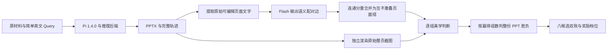

# PPT-RL

把原始材料变成可追溯的 PPTX 轨迹，再通过页面语义配对、截图美学对决和淘汰赛产生相对奖励。



## 安装

需要 Python 3.10+、Node.js **22.19+**。Pi SDK 锁定 **1.4.0**；推理后端由调用方单独部署，仓库不下载或更换权重。

```bash
python -m pip install -e '.[hub,test]'
npm ci --prefix inference/runner --cache ./runs/npm-cache
```

Pi 入口需要保留源码 checkout 中的 `inference/runner/`；也可通过 `PPT_RL_PI_RUNNER` 指定其位置。临时文件和缓存落在工作目录，不需要写用户 HOME。

## 1. 推理采集

把原始文本、PDF 和源图放在一个目录，创建真正可编辑的 `outputs/presentation.pptx`：

```bash
ppt-rl infer --materials ./data/materials --out ./runs/example \
  --config configs/flash_inference.json
```

基础 Query 统一为：`Create a PPTX presentation in English based on the provided materials.`

原始 PDF 可读文字、渲染页面、提取内嵌图、裁剪区域；生成后的演示文稿预览图反馈关闭。Pi 的 native read/write/edit/bash/grep/find、工具调用、会话、流式增量、模型请求、失败和轮次上限状态均保留。最多80个完整 assistant turn，无案例墙钟超时；请求 thinking 8192/output cap32768，不宣称所有后端都单独强制 thinking 上限。生产模式可省略 temperature；固定 rollout 通过配置指定温度和逐请求 seed。

也支持目标风格原稿（其内容不作为事实来源）：

```bash
ppt-rl infer --materials ./data/materials --out ./runs/style \
  --config configs/flash_inference.json \
  --style-template ./data/style/template.pptx \
  --style-pdf ./data/style/reference.pdf
```

`inference/runner/queue_worker.py` 保留当前 SQLite 原子领取、租约续租、过期重领和旧结果拒收适配器，见 [推理与部署](docs/inference.md)。仅结构可读的 PPTX 不等于视觉或事实质量合格。

## 2. 页面配对与分组

```bash
ppt-rl extract ./data/a.pptx --out ./runs/a-text.json
ppt-rl align --a ./data/a.pptx --b ./data/b.pptx --out ./runs/alignment
```

分组模型**只接收两份 PPT 的原生文字，没有图片**。模型给出有证据的 A 页/B 页链接；应用将共享端点的链接传递合并为二部图连通分量。允许一对一、一对多、多对一、多对多和没有对应的页面；每边每页只属于一个组，不用完全二部图补造语义边。保留原文引文及 span，严格校验重复链接、未知页和 unmatched 清单。详见 [配对与分组](docs/matching.md)。

## 3. 整稿对决与排序

`examples/eight_decks.json` 展示输入格式；一场 `duel` 使用相同结构但只放两份稿件。

```bash
ppt-rl duel --manifest ./data/two-decks.json --out ./runs/duel --config configs/local_judge.json
ppt-rl rank --manifest examples/eight_decks.json --out ./runs/rank --config configs/local_judge.json
ppt-rl plan --ids r01 r02 r03 r04 r05 r06 r07 r08 \
  --fixed examples/fixed_first_two.json --out ./runs/seven-plan.json
ppt-rl run-plan --manifest examples/eight_decks.json --plan ./runs/seven-plan.json \
  --out ./runs/seven --config configs/local_judge.json --parallel-draws 5 --global-limit 8
```

逐个页面组给评审完整原图，只问整体美学观感，明确页数没有影响；不把文字配对理由或评分量表交给美学模型。每组一票，tie不加分，谁赢组数更多谁赢整稿。原稿 canonical A/B、当次显示侧、原始 reason 和归一化胜者分开记录；复遇换序。相同来源/协议的内容分组可复用，审美判决不跨独立采样复用。

当前排序引擎支持 **8份候选**，双败14场、总决赛一场不重置。奖励：1 / 0.8 / 0.6 / 0.4 / 0.2 / 0；5–6、7–8同档。主轮平分采用配置的抽组换序加赛，比分和加赛分别留档；三组仍平分会显式等待人工决胜，不伪造模型胜者。单套是14场线性工作量；七套共98场，不保证严格全序或对签位不敏感。见 [排序、奖励与复杂度](docs/ranking.md)。

## 合格训练集

[Hugging Face: yzxjb/ppt-sft](https://huggingface.co/datasets/yzxjb/ppt-sft) 保持私有。这次只发布此前筛选合格的 **2,497条轨迹 / 4,325训练窗口 / 3,373引用图片**，不把后续 rollout、分组或对决实验混入训练集。旧消息、工具定义和逐消息 loss mask 均保留，仅将图片路径做可移植转换。

```bash
ppt-rl fetch-train --out ./data/qualified --ask-token
# 已下载 release 时：
ppt-rl prepare-local --root ./data/qualified/snapshot/qualified/20261101-v1
```

代码不保存认证凭证。训练前需要保留消息 `loss` 字段，并使用 `tools/sft_template_compat.py` 处理轨迹里被保护的字面量 `<image>`。本 release 所有保留案例都在 train，原验证案例不再是独立 holdout。见 [数据格式与溯源](docs/data.md)。

## 验证与复现

```bash
python -m pytest
node --check inference/runner/harness.mjs
node --check inference/runner/pi_runner.mjs
```

离线测试不调用真实模型；历史来源的文件 SHA、移植关系和协议版本在 [provenance](provenance/)。仓库是当前链路的可配置移植，历史实验精确请求与哈希才是原始执行证据；改变后端、字体或渲染器不保证逐字节相同输出。
